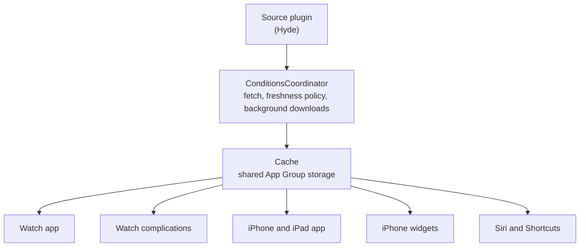

# Patrol 🌊

A glance at your wrist or your Lock Screen tells you whether it's time to go.

Wave height, period, and wind, live from weather stations, for the spots you pick.

Built for watchOS 26 ⌚️ and iOS 📱 (the iPhone app itself targets iOS 27).

## What's in it

- **Watch app**: live wind and wave pages, with a place picker.
- **Complications and widgets**: accessory widgets on the watch face, Lock Screen and Home Screen (small and medium) widgets on iPhone. Each widget shows the place you choose for it, or follows your default place.
- **iPhone and iPad app**: browse every available place and open one for its current conditions; pull to refresh.
- **Siri and Shortcuts**: "Patrol surf", "How is the surf at ‹place› in Patrol", and "Switch Patrol to ‹place›".

## Architecture

Conditions come from pluggable sources; Hyde is the first. Every surface asks the coordinator for conditions and reads what it wrote to the shared cache.



## Repository layout

- `Core/`: Swift package with the shared logic and no UI: domain types, the plugin protocol, cache, the Hyde source, the coordinator, and reusable surf views.
- `Patrol/`: the iOS and iPadOS app, which hosts the Watch app and the iOS widget extension.
- `PatrolWatchApp/`: the watchOS app.
- `PatrolWidget/`: the WidgetKit extension, built for both watchOS and iOS.
- `PatrolIntents/`: Siri and Shortcuts intents, built into both apps.
- `PatrolPlaces/`: the place picker's entity, shared by all targets.
- `Server/`: Swift package with a Hummingbird backend.
- `scripts/`: git hooks.

## Development

Build and test the packages from the repository root:

```bash
make build         # Core
make test
make server-build  # Server
make server-test
make install-hooks # once after cloning: format check before each commit
```

The app and widgets build from Xcode.

CI runs the Core and Server tests on macOS and Linux.

Code is formatted with Apple's [swift-format](https://github.com/apple/swift-format), bundled with Xcode. The pre-commit hook catches unformatted commits locally; CI checks formatting on every push and pull request regardless.
